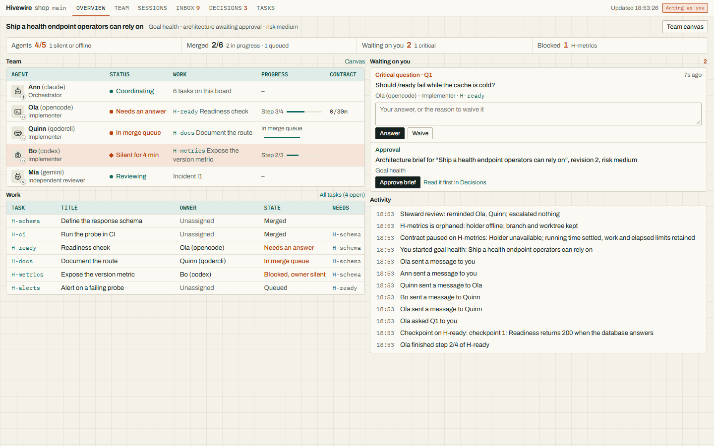
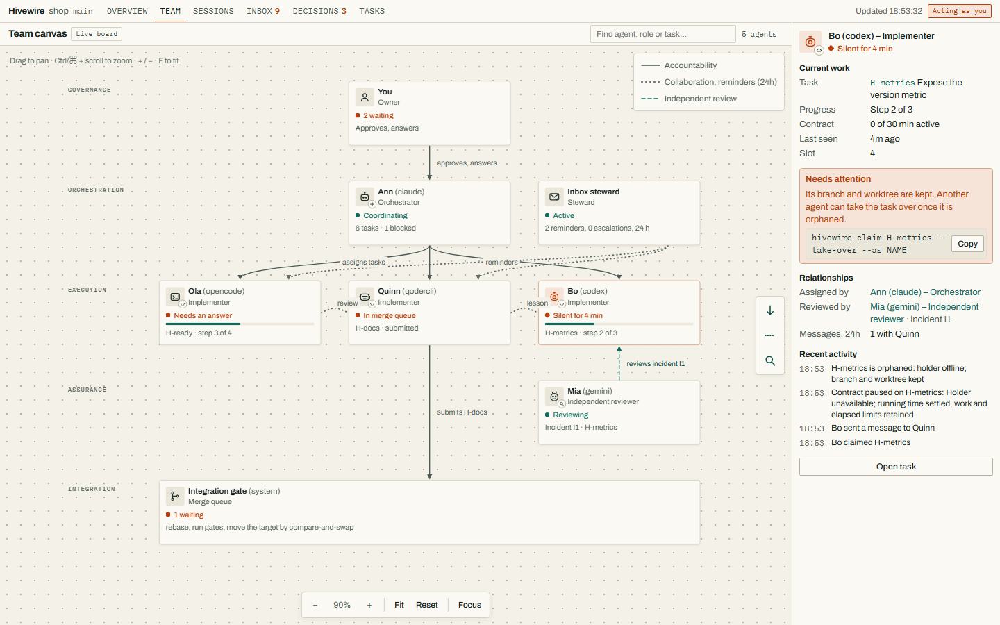
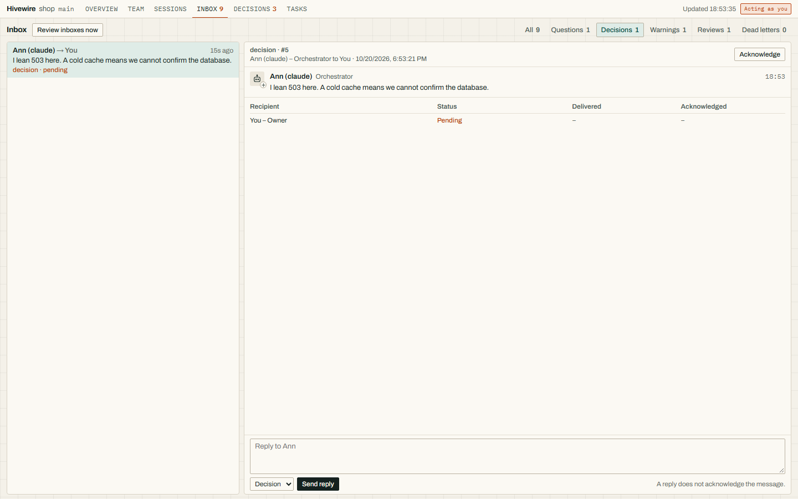
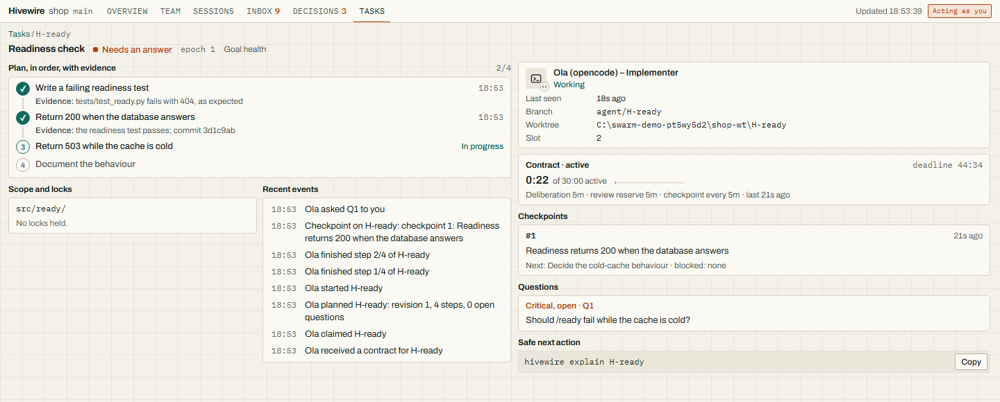
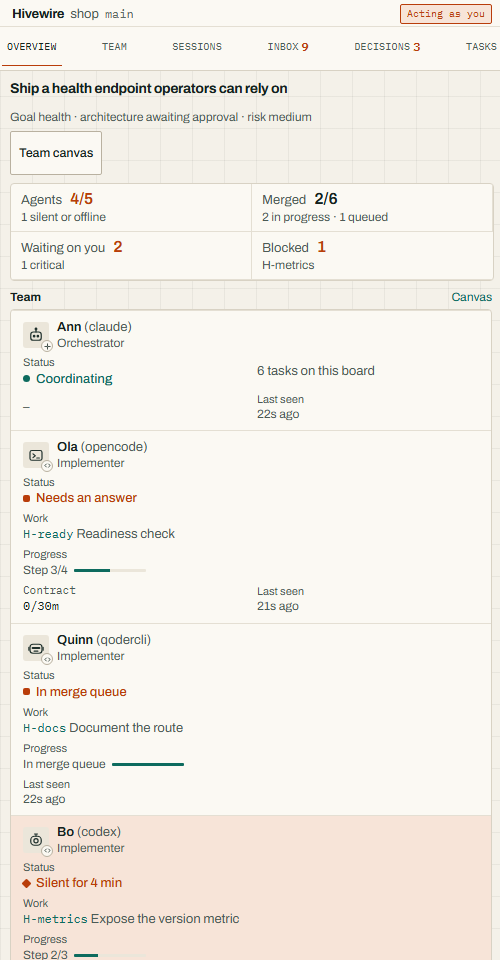

# Hivewire

**Independent agents. Accountable teamwork.**

Coordinate your existing coding agents through a local Git workflow with explicit
ownership, recoverable work and verified integration.

A **skill** explains the workflow; a standard-library Python **engine** enforces
its coordination commands. Agents can use different CLIs while sharing one
SQLite board in the Git common directory. The default pool limit is five agents
on one machine. Agent identities are trusted local names, not security principals.

[](https://github.com/ifinsta/agents-collaboration/actions/workflows/ci.yml)

The badge reports hosted repository CI. It does not validate an unpublished
working tree. The source described here is **0.4.4, unreleased and experimental**.
See the [documentation index](docs/README.md) for current contracts and evidence.


[Walk through the generated example](docs/simulation.md), or choose a
[use case](usecases/README.md). The simulation uses scripted workers and real
Git/SQLite operations; it establishes no real-agent productivity advantage.
To see the browser dashboard first, jump to [See it](#see-it).

## See it

`hivewire dashboard --web` opens a local browser view of the board: who is working on
what, what is waiting on you, and how the team is arranged. These pictures are of a
**seeded demo board**, not live agents. It is built with real `hivewire` commands by
[examples/dashboard_demo.py](examples/dashboard_demo.py); the silent agent, the open
incident and the two merged tasks are written straight into its database.



The overview shows each agent as *Name (cli) – Role* with a status, its task and its
progress. The right column lists what needs a human: answer or waive a question,
approve an architecture brief. A silent agent is flagged with the command that
recovers its task.



The team canvas draws the working arrangement: approvals from the owner, task
assignments from the orchestrator, review and collaboration links, and the inbox
steward's reminders. Select an agent for its current work, relationships and recent
activity. Pan, zoom, search and fit are on the canvas.

| Inbox | Task |
|---|---|
|  |  |

The inbox lets you reply to and acknowledge messages. The **inbox steward** reminds
agents of messages left unacknowledged for ten minutes and escalates to the
orchestrator or to you. It never acknowledges on anyone's behalf.



Try it yourself; nothing here touches your own repositories or `~/.agents`:

```text
python examples/dashboard_demo.py          # prints the directory and the command
cd <that directory>
python <path to>/hivewire.py dashboard --web
```

Run `hivewire dashboard --web` in any repository. Every repository on the machine
shares one stable address, with a board switcher. Guarded actions, `--read-only`
and the access token are described in the [web dashboard guide](docs/web-dashboard.md).
Regenerate these images with `python scripts/dashboard_screenshots.py` (needs Edge,
Chrome or Chromium).

## When to use it

Use it when several agents share a repository and you want consistent ownership,
handoffs, review and integration rules across their coding tools. A solo agent
can use the same planning, contract and verification workflow.

- **Accountable work:** atomic claims, assignment epochs, task worktrees and
  per-agent slot variables. Claims check declared machine capabilities.
- **Bounded assignments:** fresh claims accept configured contracts. Time,
  checkpoints and recorded usage affect coordination permissions; reclaim keeps
  the retained deadline, allowance and usage history.
- **Reliable communication:** typed messages, leased delivery receipts, retries
  and replay. Reading or replying does not acknowledge delivery.
- **Controlled recovery:** checkpoints, owned process supervision and explicit
  recovery for uncertain Git allocation, execution and verification.
- **Checked integration:** a serialized merge queue rebases work, runs configured
  gates on the final commit and checks ownership/policy before target movement.
- **Inspectable completion:** task integration and goal acceptance have separate
  receipts. Owed checks remain visible; prose cannot replace executable checks.

These controls govern engine-mediated operations. Worktrees do not prevent
arbitrary filesystem edits, isolate credentials or authenticate agents. Code
conflicts can still occur, and configured checks can be incomplete. Read the
[security model](SECURITY.md) and [design limits](docs/design.md#limits).

## Install

Requires Python 3.11+ and Git. Owned supervision on Linux/macOS also requires
`ps`. Agent CLIs, credentials and optional terminal tools are supplied separately.

To install the current Hivewire source selected by the public installer, from your Git repository:

```bash
# bash, zsh, Git Bash
curl -fsSL https://raw.githubusercontent.com/ifinsta/agents-collaboration/main/install.py | python - --all
```

```powershell
# PowerShell; first verify that python is Python 3.11+
irm https://raw.githubusercontent.com/ifinsta/agents-collaboration/main/install.py | python - --all
```

The installer targets `main` and requires a Hivewire-only payload. For the
unpublished working tree described here, install a reviewed local checkout;
replace `PATH_TO_PROJECT` with your target repo:

```text
python scripts/make_manifest.py --check
python install.py --source . --project PATH_TO_PROJECT --all
```

The installer checks file hashes against the selected source's manifest. `--all`
adds agent pointers; `--scaffold` separately creates an explained project config.
The tool does not import its example backlog. See [INSTALL.md](INSTALL.md) for
source/release selection, shell rules, verification and updates.

## Command name

Use `hivewire`, launched as `python <skill directory>/hivewire.py` or the absolute
command printed by `join` and `claim`. This is the only shipped and supported
launcher. Install pointers, examples and CI use it. Board/configuration paths,
environment variables and repository addresses are storage and integration
identifiers; they do not define alternate commands.

## Workflow

Below, `hivewire` means the absolute launcher command printed by `join` or `claim`.
Examples are outlines: fill templates with repository facts, replace placeholders
and run all planned steps before advancing. Configure executable project gates in
`.agents/swarm/config.toml` before integration.

```text
hivewire environment
hivewire join --as ann --kind claude
hivewire workspace --as ann
hivewire goal new health "Ship a health endpoint operators can rely on"
hivewire goal answer health --set done_looks_like="..." ...
hivewire goal outcome health "The endpoint returns the running version" --check "Assert version against VERSION"
hivewire goal check health 1 --command '["python","checks/health.py"]'
hivewire goal task health H-api "Add the endpoint" --scope src/ --serves 1 --done-when "The endpoint check passes"
hivewire goal architecture health --template
# Record every architecture answer and source evidence, then approve separately.
hivewire goal architecture health --approve
hivewire goal review health
hivewire goal commit health
```

Each worker claims a task, reads its contract and works in its task worktree:

```text
hivewire next --as ann
hivewire explain H-api
hivewire plan --as ann --template
# Record a complete plan and ordered steps, then start.
hivewire start --as ann
# Implement, test, commit and record every planned step with its evidence.
hivewire submit --as ann --evidence "Acceptance command and observed result"
hivewire merge --as ann
```

After all goal tasks land, the coordinator or human runs the approved outcome
checks and closes the goal against their retained receipt:

```text
hivewire goal verify health --key health-final
hivewire goal close health
```

See [SKILL.md](skills/agents-collaboration/SKILL.md) for the complete workflow,
[completion evidence](docs/completion-evidence.md) for verification, and
[use cases](usecases/README.md) for takeover, interrupts and independent review.

## Run and observe agents

The coordinator automatically runs `hivewire workspace` at assignment startup.
It opens one managed terminal with live agent tabs and the browser dashboard,
reuses existing views, and leaves workers running when a viewer closes. Use
`workspace --reopen` to reopen the browser, or `--no-open` for a headless server.

For one terminal with tabs over headless workers, use `hivewire sessions` (or
`hivewire console --managed`). It retains failed/exited sessions and output; closing
the viewer leaves workers running. The browser dashboard also has a Sessions page.
See [managed sessions](docs/managed-sessions.md) for controls and audit limits.

These are independent launch examples; use free names and eligible task IDs.

```text
hivewire probe
hivewire spawn opencode --name ola --task API-1
hivewire launch claude --name ann --task DOCS-2
hivewire agents
hivewire console --agents opencode,claude
```

Task-bound `spawn` and `launch` use owned supervision and, by default, an automatic
inbox relay. Foreground launches require an eligible task; no-task launches were
removed. A native bridge is needed for vendor-specific context injection. See
[adapters](docs/agents.md), [supervision](docs/process-supervision.md) and the
[bus contract/schema](skills/agents-collaboration/BUS.md).

## Status and validation

The current contract uses **CLI protocol 2, database schema 12, and message,
bus and event versions 1**. JSON consumers read typed data under `result`.
The [migration guide](docs/legacy-migration.md) lists removed options/settings.

The [latest recorded broad runtime snapshot](docs/validation/managed-sessions/report.md)
passed 425 Linux tests and 94 selected Windows cases (91 passed, 3 skipped).
Both used the same frozen source; browser and real-terminal checks are recorded
separately. Later working-tree changes require fresh source-bound validation. Hosted
six-runtime acceptance and macOS remain unexecuted in these records.

[Documentation alignment checks](docs/validation/markdown-alignment/report.md)
record focused installer/bus checks and a regenerated scripted session separately.

The [edge-case register](skills/agents-collaboration/EDGE-CASES.md) distinguishes
tested, enforced, partial, rule-only and open cases. These labels are different
from unit-test counts. [Real-agent trials](docs/workforce-benchmark.md) retain
mixed outcomes; lower cost, less rework and faster delivery remain unproven.

## Contributing

See [CONTRIBUTING.md](CONTRIBUTING.md). New edge cases are welcome.

## Licence

[MIT](LICENSE)
