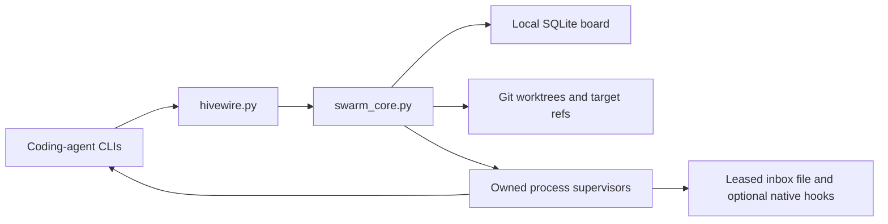
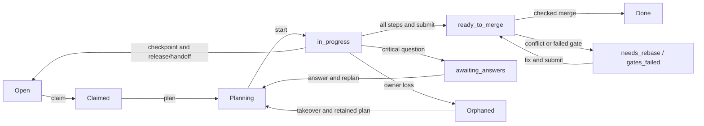

# Design

The state-changing engine is a standard-library Python module behind the
`hivewire.py` launcher. It coordinates existing coding CLIs through one local
SQLite/Git authority. Read the [skill](../skills/agents-collaboration/SKILL.md)
for commands, [bus contract](../skills/agents-collaboration/BUS.md) for transport,
and [security policy](../SECURITY.md) for the trust boundary.

Current source: CLI protocol 2, schema 13, bus/message/event versions 1;
0.4.4 remains unreleased. The [evidence index](README.md#evidence-and-release-readiness)
distinguishes implemented behavior, recorded snapshots and acceptance still owed.

## Shape



The board lives in the Git common directory, so linked worktrees share it.
Commands perform transactional state changes and liveness/recovery sweeps;
external Git/filesystem/process effects have their own recorded intent and
recovery boundaries. They do not become atomic merely because SQLite is used.
Supervisors live for their owned executions. The optional monitor adds periodic
sweeps and nudges; a separate scheduler service is unnecessary.

## Goals and assignments

Goals record repository facts, observable outcomes and executable checks, a
source-backed architecture brief and a dependency graph of tasks. Approval is
bound to the goal/brief revision; high-risk architecture requires the human.
Open migrated goals follow the same architecture rules. Historical versions
remain provenance rather than permission exemptions.

An atomic claim gives one agent a task, assignment epoch, branch, worktree and
slot variables. It accepts configured contract terms unless an offer already
exists. Custom terms use offer/accept, with one counter and a bounded decision
window. Planning must fit the contract scope and answer critical questions.
Start/step/submission commands check current permissions; they do not sandbox
arbitrary shell or filesystem activity.

A slot supplies distinct configured port/database/container names. Programs must
use those values; the engine does not reserve every OS resource they describe.
Routing checks declared capabilities, with explicit force overrides where the
CLI permits them. It cannot prove that a machine can perform every semantic
acceptance check merely by detecting installed tools.

## Task lifecycle and recovery



This diagram summarizes common paths; expiry, interrupts, allocation uncertainty
and merge-blocked states have additional guards. The implementation and refusal
messages define those transitions. A returning owner or successor with a retained
plan must pass the start/replan gate before recording more work. Takeover and
ordinary reclaim preserve the original deadline, remaining active allowance and
usage lineage. Expired terms need an explicit authorized recovery decision.

Submission stops accounted running time, so merge-queue and review waiting is not
charged to the active budget. When a `ready_to_merge` task waits behind the
serialized merge queue or a required task lock and its deadline is within
`[liveness] ready_to_merge_grace_min`, the engine records one audited
`queue_grace` deadline extension; it names the blocker, leaves the owner's one
manual extension available, and remains bounded. A coordinator or human can widen
an active contract additively with `contract scope add`; the task, epoch, queue
position and review state survive, and submit still checks every changed file
against the combined scope. `why` reports the same blockers the engine enforces,
and `inbox --wait` streams machine-readable messages without the human footer.

Checkpointed yield/cancel completion hands work back atomically. Pause retains
ownership until authorized resume. Control acknowledgements, message delivery
acknowledgements, process exit and task completion are separate facts.

## Integration and completion

Inside the serialized merge queue, the engine:

1. rebases the task branch onto the target and runs configured gates;
2. applies merge/message policy and prepares the final commit;
3. checks that final commit, policy, scope, locks and review clearance, rerunning
   gates after hooks and rejecting tracked edits made by verification;
4. records a write-ahead integration intent;
5. checks target/ownership again and advances the target with Git's checked
   fast-forward or compare-and-swap path;
6. records completion once and attempts preservation-aware cleanup.

A conflict, failed check or lost permission prevents that attempt from moving
the target. Git protects conflicting human checkout changes. Configured gates
are required for new integration; historical ungated receipts stay unconfigured.
Ignored files, edited briefs, new unmerged commits, live executions and uncertain
supervision defer cleanup rather than becoming disposable artifacts.

Git and SQLite commit separately. If Git advanced before the completion record,
recovery checks the stored intent's commit ancestry and records completion once.
A malformed or unlanded intent cannot establish success. Selected crash tests
exercise these boundaries; [transition coverage](transition-crash-audit.md) has
remaining branch/interleaving limits.

Goal acceptance then runs approved executable outcome checks against the current
target and retains its own receipt. Landed commits, current policy and settled
owed checks are required before closure. See [completion evidence](completion-evidence.md).

## Messaging and process ownership

Messages use canonical typed envelopes. Consumer leases govern delivery attempts;
only a valid bus receipt acknowledges transport. Replies preserve threads without
acknowledging their parents. Lease expiry can allow another attempt, so external
effects still require idempotency.

By default, owned headless and foreground executions relay messages to
`SWARM_BUS_INBOX`. Expiring loopback registrations carry advisory wake tokens;
readers then query SQLite. Dropped hints fall back to periodic reads. Native
bridges translate snapshots into supported vendor hooks; common transport alone
does not preempt an arbitrary model request. The [bus contract](../skills/agents-collaboration/BUS.md)
defines bounded batches, renewal, hooks, retries and critical expiry.

Only a creating supervisor's actual handles authorize termination of its Windows
job or anchored POSIX group. Captured cooperative policy sends no stop signals;
explicit terminate policy permits escalation after grace. Stored PIDs remain
observations. Uncertain execution retains artifacts and requires inspection,
with human cessation attestation labeled separately from observed termination.
See [process supervision](process-supervision.md).

## Attention and deputy coordination

A deterministic scout runs during the engine sweep. It converts observable
states — critical unacknowledged messages, unanswered decisions, stuck or
orphaned tasks, failed or aging verification, expiring contracts, aging
incidents, stale executions and inconsistent review reservations — into
deduplicated `attention_items`. Each item carries its source evidence, severity,
deadline, owner, lease epoch and one history. Repeated scans update one item;
an item survives the death of any actor, and an unowned P0/P1 past its deadline
or queue SLA gets one visible reminder to the coordinator or human. A signal is
never treated as proof of misconduct, and the scout does not adjudicate.

A coordinator or human may grant at most one active deputy lease with explicit
capabilities, exact subject scope, policy digest and coordinator term. Every
privileged deputy action rechecks the live lease in the same immediate
transaction; revocation, role change, departure, policy edit or a new
coordinator term fences it. The deputy cannot pass the coordinator check, merge,
cancel work, start an unauthorized process, approve architecture, acknowledge
another inbox, resolve its own finding or review its own incident proposal.
Scoped `incident.propose` and `interrupt.request` remain available when granted.
Activation requires an eligible signal set and a free slot; a productive agent
is never interrupted, no sixth slot is created, and minimum active time plus
cooldown limit switching. When all slots are busy, scouting and escalation
continue without joining anyone. See the [deputy benchmark](deputy-benchmark.md)
for measured mechanics and its limits.

## Optional browser preview

The working tree also contains `swarm_web.py` and `dashboard --web`. It serves a
loopback browser view with copyable CLI commands. HTTP views read SQLite through
read-only connections. Permitted page actions use a bounded POST allowlist and
invoke the existing CLI; Sessions GET endpoints remain observational. The owning server
performs normal sweeps unless `--observe` is set, so the overall process can still
update liveness/recovery state.

```text
hivewire dashboard --web --observe --no-open
```

This is an unreleased source feature. The current installer manifest file list
includes `swarm_web.py`; use a matching reviewed source installation to evaluate
it. Manifest inclusion alone does not
establish platform acceptance. The [managed-session snapshot](validation/managed-sessions/report.md)
now includes its source, with separate local browser checks; broader platform
acceptance remains open. See the [dashboard guide](web-dashboard.md).

## Startup and measurement

The launcher keeps the engine importable for bytecode caching. Less-used imports
are lazy, and config caching binds parsed policy to a checked content digest.
Startup tests bound work performed (processes/imports), rather than asserting
wall time on a busy machine. `scripts/bench.py` measures current CLI latency.
Earlier v0.4.4 latency measurements remain in [the changelog](../CHANGELOG.md);
they do not establish performance of the larger current engine.

The separate [workforce harness](workforce-benchmark.md) measures fixed task
outcomes across three workflows. Scripted and small live trials establish no
causal developer-productivity or cost advantage.

## Limits

- One machine and one clone's shared Git directory; no authenticated remote bus.
- Local names and roles are unauthenticated. Worktrees do not isolate OS access,
  credentials, arbitrary edits or processes that deliberately escape groups.
- The board is not reconstructed automatically after database loss. Preserve
  backups and inspect surviving Git artifacts with diagnostics.
- Gates establish their configured checks; they cannot establish untested
  requirements. Report missing usage and owed checks honestly.
- Supervisor polling and native-provider boundaries still affect response time.
- Hosted six-runtime acceptance, macOS execution and broader failure/provider
  coverage remain separate from the retained local snapshots.
